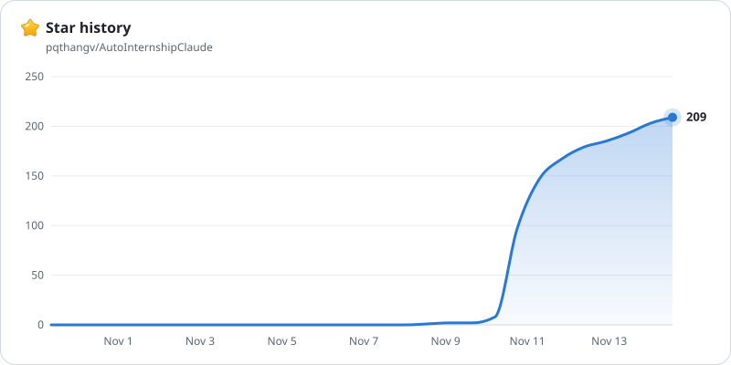

# AutoInternshipClaude

Two Claude skills and a Chrome extension for internship applications. They find postings, tailor a one-page resume to each one, fill the form and track every application. By default you review and click submit yourself. You can also ask Claude to fill everything (consent boxes and signature included), or to submit for you.

| Part | What it does |
|---|---|
| [`internship-application`](internship-application/) | Finds internships from the [SimplifyJobs](https://github.com/SimplifyJobs/Summer2027-Internships) and speedyapply ([software](https://github.com/speedyapply/2027-SWE-College-Jobs), [AI/ML](https://github.com/speedyapply/2027-AI-College-Jobs)) lists, tailors and fact-checks your resume (Overleaf or Word), writes a cover letter wherever the form has a place for one, fills the application and records what it entered. |
| [`internship-tracker`](internship-tracker/) | Keeps `tracker.xlsx` up to date with statuses, follow-ups and interview prep. |
| [`autointernship`](autointernship/) | The AutoInternship Chrome extension. Fills the predictable fields (name, contact details, school, links, yes-or-no questions, dropdowns, self-identification answers you chose) from your saved profile, instantly and without using Claude. Claude finishes the rest. |

It submits only when you ask it to, and never uses LinkedIn, never types passwords, never adds anything to your resume that isn't in your master copy, and never deletes files.

## What you need

- A paid Claude plan (Pro or higher). Skills, Cowork and Claude in Chrome all need one.
- The [Claude desktop app](https://claude.com/download) and Google Chrome.
- Your resume, in Overleaf or as a Word file.

## Install (about 10 minutes)

1. **Download this project.** Click the green **Code** button at the top of this page, then **Download ZIP**. Right-click the file and choose **Extract All** (on a Mac, double-click it). The next step uses its two skill folders.
2. **Add the two skills.** Right-click the `internship-application` folder and compress it to a ZIP (Windows: **Compress to** → **ZIP File**; Mac: **Compress**). Do the same for `internship-tracker`. In Claude, open **Customize → Skills** and upload both ZIPs. If there's no upload option, turn on code execution in **Settings → Capabilities** ([help](https://support.claude.com/en/articles/12512180-use-skills-in-claude)).
3. **Add the AutoInternship extension.** Install it from the [Chrome Web Store](https://chromewebstore.google.com/detail/autointernship/cdfkbdkmandhnmaejaknimdhepipbpin). Its profile page opens: fill it in once. See [its README](autointernship/README.md) for more.
4. **Add Claude in Chrome.** Install it from the Chrome Web Store and sign in ([help](https://support.claude.com/en/articles/12012173-get-started-with-claude-in-chrome)). It lets Claude work in your browser and press the extension's Fill button.

## Start applying

1. Make a folder for your job search with a folder named `resume` inside. Put your resume there: either your Overleaf project downloaded as **Source** (a .zip from Overleaf's menu) and unzipped, or your Word `.docx`.
2. Optional: add `profile.json` (your standard answers; use **Download backup** on the extension's profile page) and `jobs.txt` (posting links, one per line). Without `profile.json`, Claude makes one and asks only what your resume doesn't say.
3. Open the Claude desktop app, go to **Cowork** and choose your job-search folder ([help](https://support.claude.com/en/articles/13345190-get-started-with-claude-cowork)).
4. Ask Claude to apply: see [Your first batch](#your-first-batch).

In a batch, Claude tailors all the resumes at once and fills all the forms at the same time. It applies to at most two roles per company in a day, so recruiters don't see a flood of applications from you; the rest wait in `jobs.txt`.

Claude adds `Applications/` (one folder per application) and `tracker.xlsx` to your folder.

## Your first batch

Use **Opus 5.5 with medium effort** (Claude Code: `/model`, then `/effort medium`). Then ask:

> Apply to 6 jobs fill all

Claude tailors a resume for each of the next 6 postings in `jobs.txt`, fills every form and stops before Submit. You check each one and submit it.

Other requests: "Apply to 6 jobs" (leaves agreement boxes to you), "Apply to 6 jobs and submit", "Find data internships in CA".

## Using Claude Code instead

The skills you uploaded to the Claude app already work in its **Code** tab. For the command line, copy both skill folders into `~/.claude/skills/`. Then install Python 3 with `pip install openpyxl pypdf`, and [Tectonic](https://tectonic-typesetting.github.io/) so Claude can build Overleaf resumes itself. Tectonic is one file: put it on your PATH and restart Claude. Without it, you compile resumes in Overleaf. Poppler (better PDF checks) is optional.

In auto mode, Claude Code's safety check can block Claude from ticking agreement boxes or entering your profile on job sites. To allow it, add an `autoMode` rule to `~/.claude/settings.json` ([how](https://code.claude.com/docs/en/auto-mode-config)). Claude can't add the rule for you: auto mode doesn't let it loosen its own permissions.

## Star history

<a href="https://github.com/pqthangv/AutoInternshipClaude/stargazers">
  <picture>
    <source media="(prefers-color-scheme: dark)" srcset="https://raw.githubusercontent.com/pqthangv/AutoInternshipClaude/star-chart-images/stars-dark.svg">
    
  </picture>
</a>

## License

[MIT](LICENSE). This is a personal project, not affiliated with or endorsed by Anthropic.
